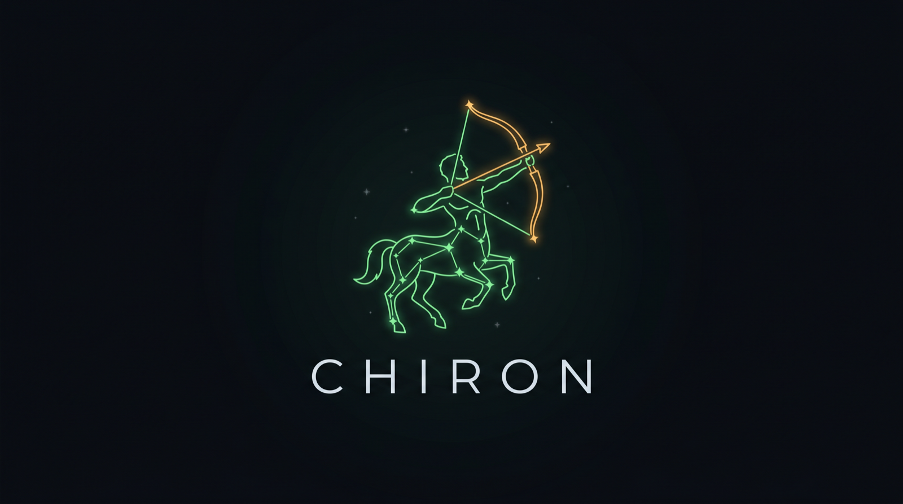

<p align="center">
  
</p>

<p align="center"><strong>Run a hard decision past Munger, Naval, Taleb, Voss and fifteen other thinkers. Each one answers from what they actually wrote, and they tell you where they disagree.</strong></p>

<p align="center">
  <a href="https://github.com/rmarji/chiron-council/actions/workflows/ci.yml"></a>
  
  
  
</p>

You're about to raise your prices, sign a contract, or have the same argument with your partner for the fifth time. You ask an AI and it agrees with you.

Chiron gives you a room of advisors instead. Each one is built from a real thinker's books, essays and talks, and every point they make comes with the source. Ask one advisor, or call a small council: they answer separately, you see where they really disagree, and you get one recommendation with the objection kept in.

It works in Claude (web, desktop and Claude Code), Codex, and the ChatGPT desktop app. It's free, MIT licensed, and needs no API key.

## Install in 60 seconds

Pick the app you already use. Each block ends with the same first question so you can see it work.

### Claude on the web or desktop (no terminal)

1. Open **Customize → Plugins → Add marketplace → Add from a repository**.
2. Paste `rmarji/chiron-council` and confirm. Leave everything else as it is.
3. Find **Chiron** under **Compound Club** and click **Install**.
4. Start a new chat and type:

   ```
   /chiron:council relationship "we keep having the same fight about money"
   ```

If you see two Chirons in your plugin list, keep the one from **Compound Club** and remove any copy under **Local uploads**. That's an older manual upload and won't update.

### Claude Code (terminal)

```
/plugin marketplace add rmarji/chiron-council
/plugin install chiron@compound-club
```

Choose **user** scope when asked, so it works in every project. When Claude Code asks to run `python3`, allow it: those scripts read Chiron's own files, and a council adds a short note to `~/.chiron/logs/<advisor>/log.md` so the advisors remember what you discussed. Then:

```
/chiron:council relationship "we keep having the same fight about money"
```

### Codex CLI

```bash
codex plugin marketplace add rmarji/chiron-council
codex plugin add chiron@compound-club
codex plugin list | grep chiron        # should say: installed, enabled  0.3.0
```

Open a **new** `codex` session (plugins load at start), then type:

```
Convene the relationship council: we keep having the same fight about money.
```

### ChatGPT desktop app

ChatGPT reads plugins from the same place Codex does, so you need the Codex CLI once.

1. In a terminal: `codex plugin marketplace add rmarji/chiron-council`
2. Quit and reopen ChatGPT.
3. Turn on **Work** mode, open **Plugins**, choose **Compound Club**, and install **Chiron**.
4. In a new chat: *Convene the relationship council: we keep having the same fight about money.*

### Claude Desktop Cowork

Download `chiron.plugin` from the [latest release](https://github.com/rmarji/chiron-council/releases/latest), open it, and click **Trust**. If nothing happens, use **Extensions → Plugins → Upload**. Check the release version against the badge above; a release file can be older than this page.

**You need** macOS or Linux and Python 3.9+ (`python3 --version` to check; macOS has it). Claude on the web needs nothing. Windows isn't supported yet.

## What a good first answer looks like

A council takes **one to three minutes**. You'll see the app read a few files and run a couple of small scripts first. That's Chiron loading each advisor's notes; it doesn't touch anything else on your computer.

Then you get something like this:

```
Two advisors looked at this: Terry Real (couples therapist) and David Deida (author on relationships).

What they'd tell you
  Terry Real: Look at your own part in the last fight before you look at theirs.
    Turn the complaint into one specific request. (Us, 2022)
  David Deida: Stay in the conversation when it gets uncomfortable. Don't agree
    just to end the tension. (The Way of the Superior Man)

Where they disagree
  Real says repair is a skill you practise together. Deida says it starts with
  your own steadiness. Both positions are from their books, not invented.

What to do
  Pick a calm moment this week and say: "In our last argument, I contributed
  by ___. Could we agree to ___?"
  The catch: the money question itself may stay open after the first talk.
  How sure: 3 out of 5. A detail from the actual fight could change this.

Want me to remember what you decide, so these advisors can follow up next time?
```

If you got a plain answer like that, with sources and one clear next step, it's working.

## Ask it anything

You don't need commands. Just say what you're weighing:

```
should I take the retainer at 15k a month or walk away?
what would Munger say about this contract?
run my pricing idea past the money council
```

Chiron picks the right advisor, or a small council, and tells you who it picked and why before it starts. For a cheap, reversible call it'll often pick one advisor. That's on purpose.

## Who's in the room

| Advisor | Good for | Built from |
|---|---|---|
| **Munger** | spotting bad incentives and avoidable mistakes | Poor Charlie's Almanack |
| **Rumelt** | strategy: what's really the problem? | Good Strategy Bad Strategy |
| **Thiel** | contrarian bets, building a monopoly | Zero to One |
| **Paul Graham** | startups and founders | his essays |
| **Hormozi** | offers and pricing | $100M Offers, $100M Leads |
| **Voss** | negotiation | Never Split the Difference |
| **Cialdini** | persuasion | Influence, Pre-Suasion |
| **Naval** | leverage and wealth | The Almanack of Naval Ravikant |
| **Taleb** | risk and uncertainty | The Black Swan, Antifragile |
| **Kahneman** | bias in decisions | Thinking, Fast and Slow |
| **Ferriss** | time, work design, fear-setting | The 4-Hour Workweek, Tools of Titans |
| **Attia** | health and longevity | Outlive |
| **Deida** | relationships and purpose | The Way of the Superior Man |
| **Terry Real** | conflict and repair in couples | Us, The New Rules of Marriage |
| **Marcus Aurelius** | staying steady under pressure | Meditations |
| **Sherlock Holmes**, **Dr. House**, **Columbo** | finding what doesn't add up | the stories and episodes |
| **Rayo OS** | shipping and deciding fast | the author's own framework (optional) |

Every advisor talks *about* the thinker ("Munger's writing says…"); none of them pretends to be the person, and none is endorsed by them. Rayo OS is the author's personal operating system, shared as an example of an advisor built from your own rules. You can make one of yourself with `/chiron:distill-me`.

## Councils you can call by name

A council is a saved group of advisors. Six come ready to use:

| Name | Who sits on it |
|---|---|
| `relationship` | Deida, Terry Real |
| `money` | Munger, Naval, Hormozi |
| `deals` | Voss, Munger, Cialdini |
| `strategy` | Rumelt, Munger, Naval |
| `work-design` | Ferriss, Hormozi, Naval |
| `shipping` | Rayo OS, Naval, Rumelt |

Make your own with `/chiron:bench create` (in Codex and ChatGPT, just ask: "make me a council called hiring with Munger and Voss"). Your first saved council replaces these examples, so Chiron offers to copy them in first.

## Make it yours (optional)

`/chiron:onboard` takes about five minutes. It shows you the advisors, asks five short questions about what you're working on, builds a few councils around your answers, and finishes by running a real decision of yours through one. (In Codex and ChatGPT, say "set up Chiron for me".)

Want an advisor who isn't here? `/chiron:distill "Ray Dalio's Principles"` researches their published work and builds one, with sources.

## Where your data goes

Everything stays on your computer as plain files in `~/.chiron/`: what each advisor told you, and any decision you chose to record. Nothing is sent anywhere except to the AI app you're already using. Delete the folder to forget everything.

## When something's off

| What you see | What to do |
|---|---|
| Two Chiron plugins in Claude's list | Remove the one under **Local uploads**; keep **Compound Club**. |
| claude.ai installed an older version | The repository dialog always uses the main branch. Remove and re-add the marketplace to refresh. |
| Codex doesn't know about Chiron | Start a new `codex` session. Plugins load when a session starts. |
| Codex saved notes in `.chiron/` inside your project | Codex couldn't write to your home folder, so it saved them next to your project. That's fine; approve the write next time if you want one shared history. |
| Claude Code asks about `python3` | Allow it. The scripts read Chiron's files and add short notes under `~/.chiron/logs/`. |
| `/chiron:...` does nothing in Codex or ChatGPT | Those apps don't have slash commands. Ask in plain words instead. |
| You're on Windows | Not supported yet. WSL may work but hasn't been tested. |

More in [docs/troubleshooting.md](docs/troubleshooting.md).

## Learn more

- [Commands](docs/commands.md): every command, with examples
- [How councils work](docs/concepts.md): why the advisors answer separately, and where the disagreements come from
- [Build an advisor](docs/distilling.md), including one of yourself
- [Why Chiron is built this way](docs/why-chiron.md)
- [Use the advisors in Cursor, Gemini CLI and other agents](docs/portability.md)
- [Contributing](CONTRIBUTING.md) · [Changelog](CHANGELOG.md) · [Legal and sources](LEGAL.md)

MIT licensed. Ideas are paraphrased and cited from published work; quotes are short and attributed. Each advisor is an independent study aid, not affiliated with or endorsed by the person it's based on.
